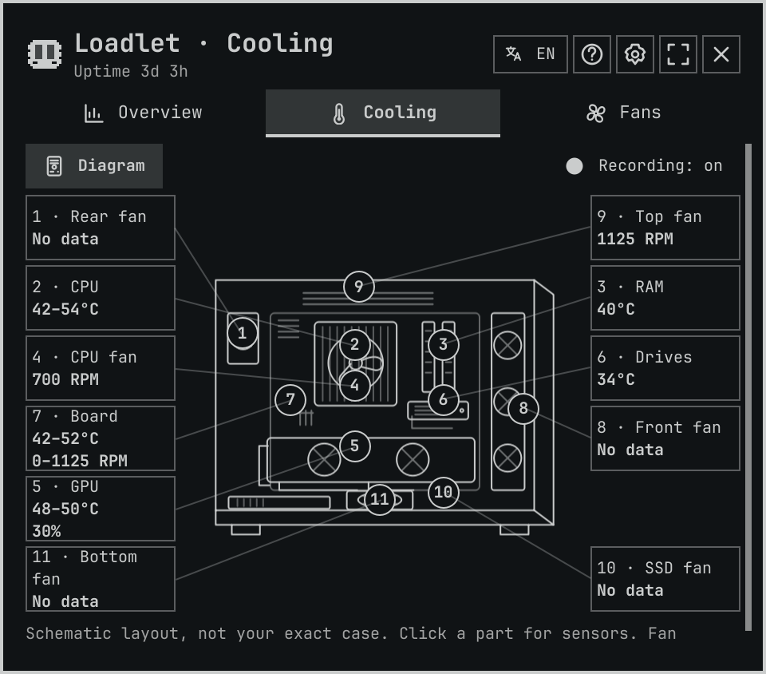
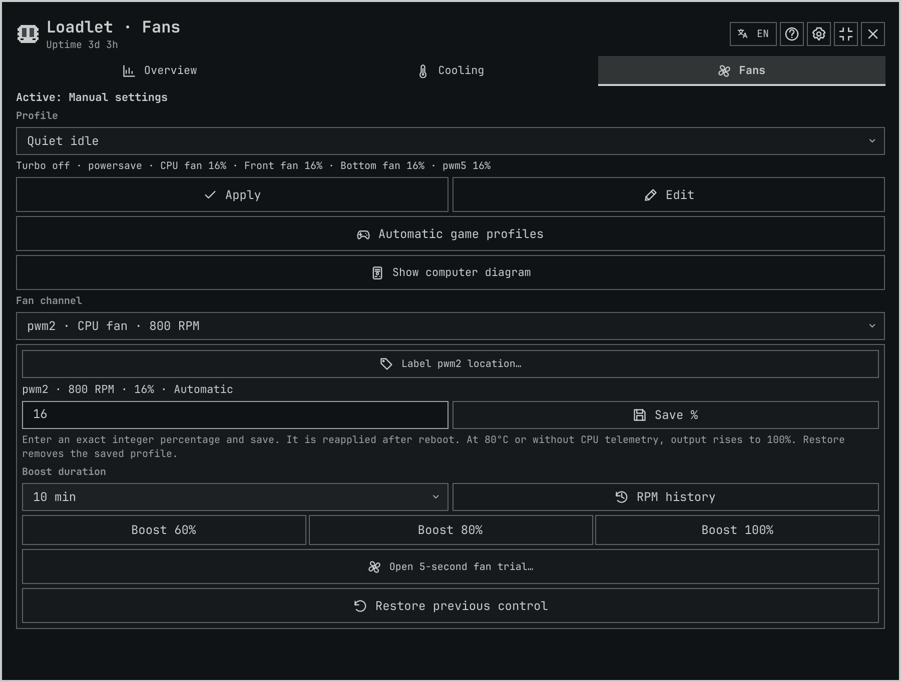

# Loadlet

A native Omarchy system monitor with a CPU/RAM character, per-GPU process usage,
sensor history, and optional automatic CPU and cooling profiles for Steam games.

[Releases](https://github.com/PavelLizunov/omarchy-loadlet/releases) ·
[Guide](docs/guide.md) · [Changelog](CHANGELOG.md)

[](docs/video/2.17.2/README.md)

[Watch the 24-second walkthrough](docs/video/2.17.2/loadlet-2.17.2.mp4)

## Install

Requires Omarchy Quattro, Linux x86_64, Git and Python 3. The sampler is included;
no compiler, make or first-run download is required.

```sh
omarchy plugin add https://github.com/PavelLizunov/omarchy-loadlet.git --enable
```

The plugin runs unsandboxed with your user permissions inside the existing shared
shell. Ordinary monitoring needs no root access and makes no runtime network
requests. Installation does not replace an existing plugin with the same ID.
[Binary source and reproducibility](docs/binary-provenance.md).

## Use

Click the bar character to open Loadlet. CPU fills its left eye, RAM the right.
Expand the panel for per-GPU processes and detailed resources. Cooling groups
sensors by component and offers bounded, opt-in history. Unknown readings stay
unavailable; manual sensor locations do not claim physical connector identity.

Fans offers named profiles combining fan output with CPU boost, governor, energy
preference and a frequency cap. Optional automatic switching detects Steam/Proton
game processes, selects Games, and returns to your non-game preset after exit.
It works with the panel closed. Non-Steam games without Steam metadata are not
currently detected. Select a preset to inspect it, then Apply or Edit. New profile
and Edit open a dedicated page with CPU and cooling sections. Save only updates
the preset; Apply on Fans activates it. Manual control cancels automation.
The computer map shows fresh temperatures and RPM beside its component points.
No guaranteed noise, temperature, power or performance improvement.

Settings → History offers opt-in 250/500/1000 ms CPU diagnostics, incident markers,
correlated local charts and an on-demand Pi answer inside the panel. Start/Stop and
the interval are saved; recording resumes in a new session after shell reload.
Recording runs in the existing reader, with bounded storage and no automatic AI
calls. Ask an agent discovers installed runners. Pi offers inline analysis with
named model choices; other agents receive an explicit terminal handoff. Manual
inline analysis sends a small summary to your configured Pi provider.
[Usage and limits](docs/fast-diagnostics.md).



## Optional system controls

Monitoring and process actions work without these helpers. CPU/fan control needs
explicit authenticated installation of root-owned Python helpers, systemd and
Polkit/sudo. Motherboard output supports only DRFXI/IT8613; optional NVIDIA output
uses NVML and driver-reported limits. There is no generic PSU fan control.

The control adapter maintains system services and a 24-hour, fixed-helper sudoers
grant. Saved output can persist after logout or plugin removal. Read the
[setup, limits and complete removal procedure](docs/guide.md#optional-controls-installation-and-removal)
before enabling it. Ordinary plugin updates do not replace root-owned helpers.

## Update and remove

```sh
omarchy plugin update slovn.activity-lite
omarchy plugin remove slovn.activity-lite
```

Before removing an installation with optional controls, disable automatic mode
and restore original control as described in the guide. Plugin removal alone does
not uninstall system helpers/services or delete your local history.

## Development and support

[Build and checks](docs/guide.md#build-and-install) ·
[2.16.0 audit evidence and limits](docs/release-2.16.0.md) ·
[Issues](https://github.com/PavelLizunov/omarchy-loadlet/issues)

Russian, English, German and Simplified Chinese are currently translated.
The [50-locale Omarchy migration](docs/localization.md) is in progress. Report the plugin
version, Omarchy version and reproducible steps. Do not post private diagnostic
exports without reviewing them. Marketplace review is commit-specific and separate
from GitHub releases; a listing badge does not certify current upstream code.

MIT licensed. Derived from Kristoffer Haugland's Activity Monitor;
[attributions](ATTRIBUTIONS.md) retain upstream and adapted-control provenance.
