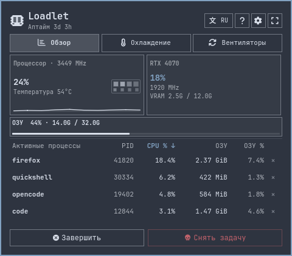
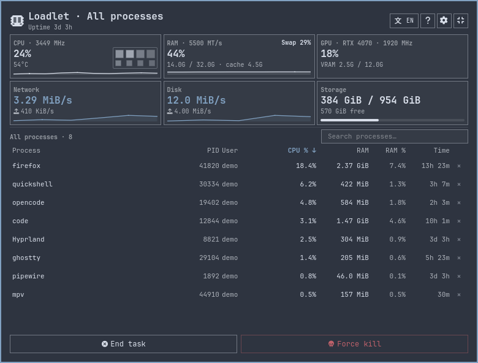
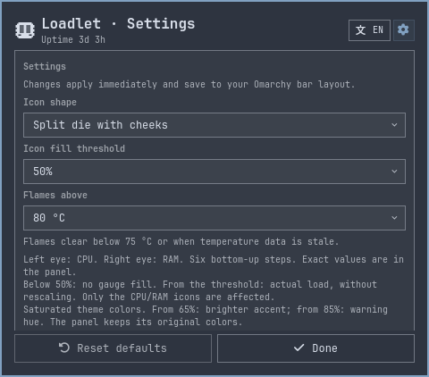
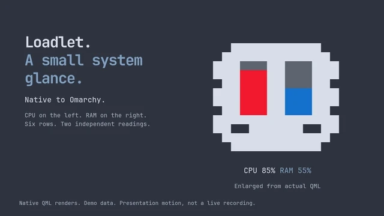

# Loadlet

A small native Omarchy system monitor with a load-indicating character. CPU,
memory, temperature and sampled processes are one click away.

[Install](#install) · [Build from source](docs/guide.md#build-and-install) · [Controls and limits](docs/guide.md)

## Install

Requires Omarchy Quattro on Linux x86_64, Git and Python 3, normally supplied
by Omarchy. No compiler, make, extra package or manual build is needed.

```sh
omarchy plugin add https://github.com/PavelLizunov/omarchy-loadlet.git --enable
```

Review the source, accept Omarchy's add prompt and choose the bar position.
The ready-to-run sampler is included; its source and build provenance are
[documented](docs/binary-provenance.md). The plugin runs with your user permissions
inside the shared shell. No root access, second shell, first-run download or
background compilation is used. An existing installation is not overwritten.

Update an installation added this way with `omarchy plugin update slovn.activity-lite`.
See [the guide](docs/guide.md#build-and-install) for updates and optional source builds.
The Marketplace's current **Manual setup** flag is a separate listing setting;
removing it requires a maintainer to review the packaged-binary evidence. Until
that change appears, use the command above from the source link.



Actual native QML, rendered offscreen with inert demonstration data. These images
are not desktop captures or measurements of a machine.

## One icon, exact readings

The left eye shows CPU and the right eye shows RAM. Six bottom-up rows indicate
approximate load. The fill threshold defaults to50%: below it tracks stay empty;
at or above it the original percentage scale is preserved. Exact readings and
freshness remain in the tooltip and panel. Fresh temperature can add flames and
brief optional motion without changing sampling cadence.

Left-click toggles the panel. Right-click has no action. Expand inside the panel
for GPU, storage, search and the full sampled process list. No separate Task
Manager application is launched or required. Each GPU has its own wrapping card.

The **Cooling** tab shows available hwmon temperatures and fan readings plus
NVIDIA temperature/fan telemetry through the existing NVML provider. It reuses
the native sampler and Sparkline component, without a new service or dependency.
Choose a 1/3/10-minute graph window. Up to 240 samples are kept in memory while
the tab is open, updating about every 3 seconds. Missing driver sensors are
reported explicitly; NVIDIA percentages are not mislabeled as physical RPM.
Device categories/models and reading meanings replace driver-only sensor headings.
Settings offers four compact tile slots, including CPU temperature and individual
GPUs. Uniform tile sizing keeps CPU core grids inside their cards.



Process actions use sampled PID/start time and ownership guards. Force kill needs
separate confirmation. There is no automatic escalation or privileged helper.
Diagnostic history is local, opt-in and off by default; exports prepare evidence
without running an AI or changing system settings.



<p align="center">
  
</p>

A newly rendered silent16-second walkthrough of the current Loadlet interface.
The complete animated film plays here. Cuts/camera moves are presentation, not
native transitions or a live recording.

[Master MP4](docs/video/loadlet.mp4) · [Messenger MP4](docs/video/loadlet-web.mp4) ·
[Video source and QA](docs/video/README.md)

## Optional source build

This developer workflow is not required for normal installation.
Requires Linux with the Omarchy shell, make, a system C++17 compiler and Python3.
Tests also use Node.js and Qt Quick Test. NVIDIA metrics optionally use the
installed driver's NVML; no telemetry daemon or runtime network is required.

```sh
git clone https://github.com/PavelLizunov/omarchy-loadlet.git
cd omarchy-loadlet
make -B activity-sampler
make check
make install-local
omarchy-shell shell rescanPlugins
omarchy plugin enable slovn.activity-lite left
```

The stable plugin ID `slovn.activity-lite` preserves compatibility with existing
settings/reports. The installer refuses to overwrite an existing copy. Follow
[the guide](docs/guide.md#build-and-install) for reviewed updates and troubleshooting.
Remove the widget without deleting diagnostic reports:

```sh
omarchy plugin disable slovn.activity-lite
omarchy plugin remove slovn.activity-lite
```

## Development and provenance

[Guide](docs/guide.md) · [Verification](VERIFICATION.md) ·
[Visual provenance](docs/images/README.md) · [MIT attribution](ATTRIBUTIONS.md)

Maintained at [PavelLizunov/omarchy-loadlet](https://github.com/PavelLizunov/omarchy-loadlet).
Derived from Kristoffer Haugland's Activity Monitor; the original MIT license,
attribution and pinned upstream bytes are retained. This repository starts with a reviewed
public snapshot, without importing private diagnostic development history.
Loadlet is listed in Marketplace. The revised no-build installation path and
package evidence need separate maintainer review before its Manual setup flag changes.

Russian is the default interface language; English, German and Simplified Chinese
are supported. The Loadlet name is unchanged across locales.

The plugin runs with your user permissions inside the shared Omarchy shell.
Offscreen/native tests do not certify every theme, physical pointer/focus,
screen-reader support, hardware telemetry or battery cost.
