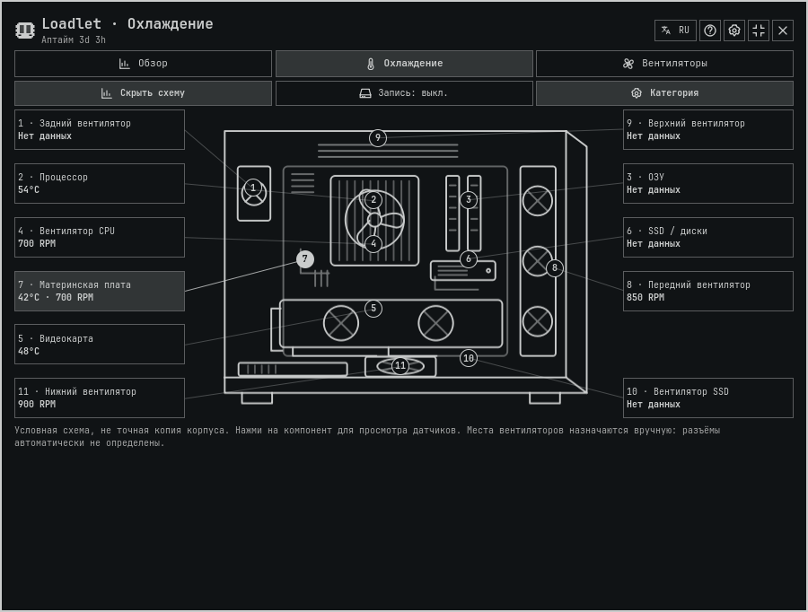
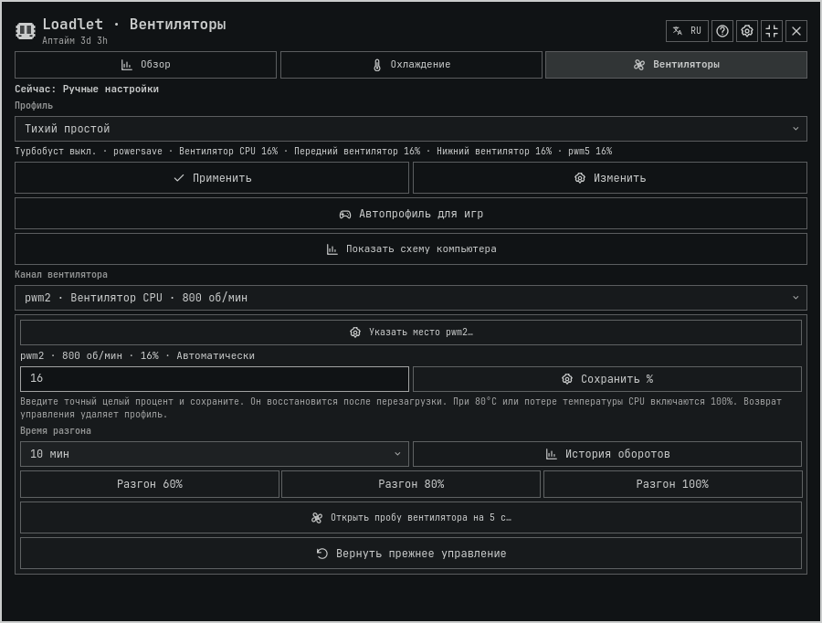
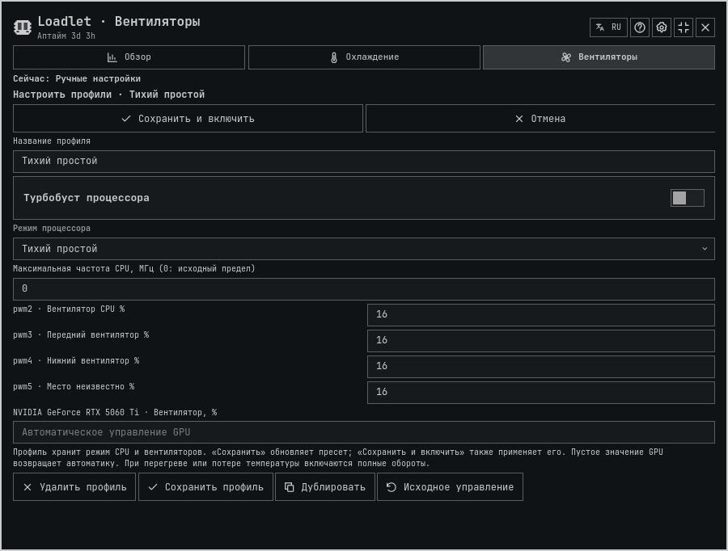

# Profiles and live computer map — 2.17.0 checkpoint

## Requested change and reference

The user reported that profiles were difficult to use and requested useful live
readings next to schematic points, not merely links into other pages.
Baseline: aca5da0a0c9be79416f00ae02f7e66e13346cd19.

The [KDE PowerDevil guide](https://docs.kde.org/stable_kf6/en/powerdevil/kcontrol/powerdevil/)
distinguishes quick profile changes from configuring policy. This is a workflow
reference, not a copied interface or dependency. Native Omarchy components,
palette, fonts and existing Loadlet drawing remain the visual contract.

## Changes

- Profile selection is inert. Apply and Edit are explicit, and Edit opens the
  selected preset rather than a previously edited one. Active status and the
  selected preset summary are separate.
- Save and apply is available immediately in the editor. Save alone retains the
  preset without applying it. Cancel and Escape discard the draft. Channel
  controls are hidden while editing; the outer panel keeps its existing size.
- Duplicate, bounded preset count and protected active/automation presets remain.
  Deletion requires a second click. Invalid percentages/frequency are reported.
- Automatic game profiles has a disclosure and an explicit non-game return
  preset. Browsing a preset does not stop automation; applying it does. Editing
  a stored automation preset still requires re-enabling automation to refresh
  its privileged copy, and the editor explains this existing limitation.
- The map connects labeled temperature/RPM/percentage callouts to the existing
  points. Multiple readings use min–max ranges, with per-sensor hover details.
  It honors manual categories and fan places. Stale, absent and invalid readings
  stay unavailable; zero RPM remains a valid reading. GPU percent is not RPM.
- No new process, sensor cadence, hardware mapping or root-helper behavior.
  Saved names, settings, presets and output percentages are not migrated.

## Evidence and limitations

- Actual consumer with inert process/file/IPC adapters: 85 Qt Quick Test results
  passed, including new browse/edit/cancel/apply, explicit automatic baseline,
  invalid-draft, map mapping/range/staleness checks. Native icon raster checks
  included by the existing UI runner also passed.
- Four catalogs / 261 keys passed coverage and placeholder parity. New language
  text used local fallback; no separate translation or anti-slop skill was
  available. No fluent-human German/Chinese review is claimed.
- Package provenance, source-pinned media manifest and isolated native packaged
  add/enable/update checks passed. Full make check, a new general audit and
  physical control trials were not run for this focused UX task.
- Five final actual-consumer offscreen PNGs were inspected: map, profiles, editor,
  English automation and compact Russian map at DPR2. Source hashes and assets
  are in images/profile-ux-2.17.0/manifest.json. Qt6.12.0/software renderer0.3.0.
  AT-SPI/atk-bridge warnings use report policy, not strict-warning acceptance or
  screen-reader verification. No production panel capture or independent review.
- At compact width the schematic is smaller; long category names may elide and
  full names remain in hover text. The fixed frame scrolls rather than hiding
  lower controls. Long mixed readings wrap. User acceptance is still pending.

Installed 22 runtime files under runtime-2.17.0-profile-ux-20261029 and rescanned
only the existing shared shell. Settings remained byte-identical. Root helpers,
fan workers and active physical profiles were not changed. The first status
request during reload reported Target not found; the next returned ready,
error empty, iconRevision2.17.0 and the exact new Panel.qml URL, panel closed.
Source checkpoint publication is separate from a GitHub release; v2.16.0 and
main are not advanced by this UX delivery.
